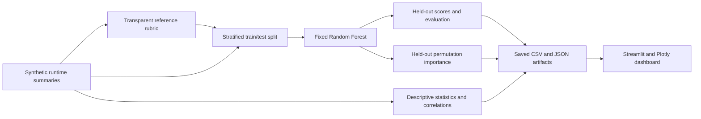

# AI-Based UVM Testbench Quality Scoring

## Overview

**Personal Project** — a reproducible Python study of UVM testbench quality from runtime behavioural summaries, with a local engineering analytics dashboard.

The pipeline analyses **550 synthetic execution summaries and 24 behavioural metrics**, assigns a transparent reference score/category, trains a fixed classifier, and evaluates held-out agreement. The dashboard explores the saved results without retraining. Python synthesises the summaries directly; they are not logs from executed RTL simulations. The SystemVerilog/UVM example separately illustrates runtime instrumentation.

## Technologies used

Python, Pandas, NumPy, Scikit-learn, Streamlit, Plotly, pytest, SystemVerilog, and UVM. Exact direct and transitive Python dependencies are pinned in [requirements.txt](requirements.txt). The scoring model and its numerical dependency versions are unchanged by the dashboard addition.

## Project architecture



The [pipeline](src/pipeline.py) generates and evaluates data. The [dashboard loader](dashboard/data.py) validates and reconciles all seven saved artifacts before the [app](dashboard/app.py) displays them. No dashboard page trains a model or calls an external API. The UVM example is independent of this Python flow; there is no simulator-log ingestion bridge.

## Behavioural metrics

These are synthetic run-level values. Counts are nonnegative integers and fractions lie in [0, 1].

| Metric | Meaning / units |
| --- | --- |
| `stimulus_types` | Distinct stimulus types |
| `unique_addresses` | Distinct addresses; no more than the transaction count |
| `payload_entropy` | Payload-symbol entropy in bits, bounded to [0, 8] |
| `stimulus_reuse_ratio` | Reused stimulus fraction |
| `corner_case_ratio` | Corner-case stimulus fraction |
| `randomization_success` | Successful randomization fraction |
| `assertion_checks` | Total assertion checks |
| `assertion_pass_ratio` | `(assertion_checks - assertion_failures) / assertion_checks` |
| `assertion_failures` | Failed checks, sampled from a binomial distribution |
| `coverage_initial` | Initially hit bins / 400 |
| `coverage_final` | Finally hit bins / 400 |
| `coverage_growth` | Final minus initial coverage, a fraction rather than a growth rate |
| `coverage_bins_hit` | Finally hit bins out of a fixed 400-bin universe |
| `warning_count` | Total warning events |
| `warning_bursts` | Disjoint groups with at least two warnings; at most `warning_count // 2` |
| `error_count` | Total error events |
| `idle_fraction` | Runtime fraction spent idle |
| `transaction_count` | Total transactions |
| `transactions_per_ms` | `transaction_count / runtime_ms` |
| `component_pairs` | Distinct interacting component pairs |
| `component_messages` | Inter-component messages |
| `response_latency_us` | Mean response latency in microseconds |
| `protocol_retries` | Retry count |
| `runtime_ms` | Total runtime in milliseconds |

The [UVM monitor](rtl/uvm_runtime_metrics_example.sv) illustrates explicit hooks for stimulus, addresses/payloads, randomization, transactions, assertions, coverage-bin hits, warnings/bursts, errors/retries, disjoint idle intervals, and component messages. It reports the 24 metric names. The [small smoke test](rtl/quality_monitor_smoke.sv) exercises these hooks without a DUT. Warning bursts in this example use a 10 ns gap rule; its counters are illustrative and are not the source of the synthetic Python dataset.

## Dataset description

Default: **550 independent synthetic summaries**, seed **42**. Reference categories contain **116 low, 278 medium, and 156 high** executions. A shared latent factor intentionally correlates many metrics; it is not exported or passed to the model. Derived assertion, coverage, warning and transaction metrics obey consistent count/rate identities.

[synthetic_executions.csv](outputs/synthetic_executions.csv) contains all 24 features, execution IDs, reference scores/categories, and split membership. The **440 training runs** and **110 held-out runs** are disjoint. Only the held-out runs have model predictions in [quality_assessments.csv](outputs/quality_assessments.csv); training runs display reference information and metrics without invented model scores.

## Machine-learning methodology

A fixed Random Forest uses **100 trees, maximum depth 8, minimum leaf size 3, one worker, and model seed 42**. A stratified run-level holdout uses split seed 43 and a 20% test fraction. Exactly the 24 named metrics are allowed as predictors. IDs, reference scores, labels, and split membership are excluded. The holdout is not used for fitting, hyperparameter tuning, or feature selection. Small datasets must retain all three categories in both subsets or evaluation fails clearly.

The saved statistical analysis comprises overall and per-reference-category count, mean, sample standard deviation, min, quartiles and max, plus Spearman correlations. These summaries do not feed training. Permutation importance measures the held-out accuracy change after shuffling each metric, with **10 repeats**. Its standard deviation describes permutation variability, not a confidence interval. Negative importance is retained. Correlated or derived metrics may substitute for one another, so global importance is neither causal evidence nor an individual model attribution.

## Quality scoring approach

Reference scores are an illustrative weighted rubric. Clip each normalized term to [0, 1], multiply by its weight, sum, then multiply by 100:

| Normalized reference term | Weight |
| --- | ---: |
| `coverage_growth / 0.7` | 0.28 |
| `corner_case_ratio / 0.7` | 0.17 |
| `1 - idle_fraction` | 0.17 |
| `randomization_success` | 0.12 |
| `component_pairs / 22` | 0.13 |
| `assertion_checks / 850` | 0.13 |

Reference categories: **low** for score <42, **medium** for 42 ≤ score <69, **high** for score ≥69. These weights and thresholds are transparent assumptions, not expert annotations; the rubric does not directly penalize errors or assertion failures.

The separate model score is:

```text
quality_score_0_100 = round(0 * P(low) + 50 * P(medium) + 100 * P(high), 2)
predicted_category = maximum-probability class
confidence = maximum predicted probability
```

Probability columns are aligned by class name, not by scikit-learn's alphabetical class order. Confidence is uncalibrated. Thresholding the expected model score with the reference rubric's boundaries need not reproduce the predicted category. Per-run evidence includes the exported probabilities, score arithmetic, observed metrics, reference medians, and reconstructed reference-rubric contributions. Those rubric contributions explain the reference label, not the forest's local decision. No original UVM logs or tree-level local explanations are fabricated.

## Evaluation results

Actual fresh default run: **550 summaries, 24 metrics, 440 training / 110 held-out**. Results are recovery of **synthetic rubric-defined categories**, not agreement with independently annotated expert assessments.

| Measure | Result |
| --- | ---: |
| Correct held-out predictions | 108 / 110 |
| Agreement accuracy | **98.18%** |
| Balanced accuracy | **97.85%** |
| Macro F1 | **0.9830** |
| 95% Wilson interval for accuracy | 93.61%–99.50% |
| Training-majority baseline on holdout | 50.91% (always medium) |
| 90% point-accuracy target | Met |
| Mean model score, 110 held-out runs | 53.82 / 100 |

Confusion matrix: reference rows, predicted columns, in low/medium/high order.

| Reference / predicted | Low | Medium | High |
| --- | ---: | ---: | ---: |
| Low | 23 | 0 | 0 |
| Medium | 0 | 56 | 0 |
| High | 0 | 2 | 29 |

Full precision, per-class precision/recall/F1, seeds, split counts, scoring rules, model parameters, scoring dependency versions and the dataset SHA-256 are in [evaluation.json](outputs/evaluation.json). [Git attributes](.gitattributes) preserve LF line endings so checkout conversion cannot invalidate the dataset fingerprint. The Wilson interval is a binomial approximation; it does not capture generator/model uncertainty or stratification effects. Additional unchanged 550-run checks previously achieved 96.36% at seed 0, 96.36% at seed 1, and 98.18% at seed 4294967295; these are generator sensitivity checks, not external validation.

## Dashboard features

- **Overview:** corpus size, metric count, global agreement, mean selected held-out score, and clearly labelled reference or predicted category counts.
- **Quality analysis:** score/category distributions, score trends by execution ID, and high/low reference group comparisons as illustrative proxies for productive versus low-value activity. IDs are not timestamps; no human productivity improvement is claimed.
- **Behavioural metrics:** interactive stimulus, assertion, coverage, warning, idle/traffic, latency and component charts, plus saved descriptive statistics and selectable Spearman correlations.
- **Feature importance:** global permutation importance with standard deviations, including negative values and correlation caveats.
- **Individual execution:** ID selection, metrics, predicted/reference categories, probabilities, confidence, score arithmetic, source IDs/fingerprint, and reference rubric reconstruction. Training runs are explicitly marked as not assessed by the exported holdout report.
- **Model evaluation:** accuracy, balanced accuracy, macro F1, target comparison, confusion matrix, classification report and provenance, all labelled as synthetic agreement.

The sidebar filters by category basis, quality category and execution ID range. Corpus-wide evaluation, importance and saved statistics remain global and are labelled accordingly. Other views follow filters. Empty selections and missing, malformed, stale or inconsistent files produce understandable messages. File signatures invalidate the read cache when outputs change. All charts use saved outputs; the dashboard adds no data generation, model fitting, authentication, database or external API.

## Installation instructions

Validated on **CPython 3.14.2 / Windows** with the pinned dependencies. PyArrow 23.0.0 is pinned for compatibility with the validated environment. Other platforms may run the same commands but were not validated for byte-identical numerical results.

Create and activate a virtual environment in PowerShell:

```powershell
python -m venv .venv
.\.venv\Scripts\Activate.ps1
```

On POSIX, activate with `source .venv/bin/activate`. With the environment active:

```bash
pip install -r requirements.txt
python -m pip check
```

If PowerShell activation is restricted, invoke `.\.venv\Scripts\python.exe` and `.\.venv\Scripts\streamlit.exe` directly instead. Do not commit virtual environments or secrets.

## Running the pipeline

```bash
python src/pipeline.py --output outputs
```

Explicit reproducibility parameters:

```bash
python src/pipeline.py --runs 550 --seed 42 --output outputs
```

Smaller datasets (minimum 30) are supported for tests; project results use 550. Seeds are integers from 0 through `2**32 - 1`. Generation/splitting validation completes before output files are written. Keep all seven outputs together:

| Output | Contents |
| --- | --- |
| [synthetic_executions.csv](outputs/synthetic_executions.csv) | All runs, metrics, reference score/category and split |
| [quality_assessments.csv](outputs/quality_assessments.csv) | Held-out predictions, probabilities, confidence and model score |
| [metric_statistics.csv](outputs/metric_statistics.csv) | Overall descriptive statistics |
| [metric_statistics_by_category.csv](outputs/metric_statistics_by_category.csv) | Descriptive statistics by reference category |
| [metric_correlations.csv](outputs/metric_correlations.csv) | Spearman correlations |
| [feature_importance.csv](outputs/feature_importance.csv) | Held-out permutation importance and standard deviation |
| [evaluation.json](outputs/evaluation.json) | Evaluation and reproducibility metadata |

For the optional UVM example, configure a compatible simulator with the [Accellera IEEE 1800.2 UVM library](https://www.accellera.org/downloads/standards/uvm). Compile [uvm_runtime_metrics_example.sv](rtl/uvm_runtime_metrics_example.sv) before [quality_monitor_smoke.sv](rtl/quality_monitor_smoke.sv), then select top `quality_monitor_smoke`. The example uses standard factory registration, component phases, reporting macros and run-phase objections. No compatible UVM simulator was available during validation, so successful simulation is not claimed.

## Running the dashboard

```bash
streamlit run dashboard/app.py
```

Open **http://127.0.0.1:8501**. The app binds locally and usage telemetry is disabled by [.streamlit/config.toml](.streamlit/config.toml). It reads [outputs/](outputs/) relative to the project, regardless of the launch working directory. The optional `UVM_OUTPUT_DIR` environment variable selects another complete local output directory. Regenerate missing or inconsistent artifacts with the pipeline command; the app will not silently replace them.

## Testing

```bash
python -m pytest -q
```

For strict warning checks:

```bash
python -m pytest -q -W error
```

The [pipeline tests](tests/test_pipeline.py) cover metric identities/ranges, rubric boundaries, class-order score mapping, train/test isolation, feature allowlisting, reproducibility, model/importance reconstruction from saved data, and reconciliation of reports with predictions. The [dashboard tests](tests/test_dashboard.py) use pytest and Streamlit's built-in AppTest to check all six pages/charts, filters, per-execution source values, training-run handling, no model fitting or output mutation, and understandable file errors. No additional UI testing framework is required.

Latest validation: **77 tests passed** (36 pipeline, 41 dashboard), including with warnings treated as errors; dependency checks passed. All seven outputs matched byte-for-byte across fresh default runs. The live Streamlit page and health endpoint returned HTTP 200, charts rendered from the saved outputs, and a 390-pixel viewport had no horizontal overflow.

## Project structure

```text
uvm-testbench-quality-scoring/
  .streamlit/config.toml          Local dashboard theme and server settings
  dashboard/
    __init__.py
    app.py                       Streamlit / Plotly presentation
    data.py                      Artifact loading, validation and filtering
  src/pipeline.py                Existing synthetic generation and scoring
  rtl/
    uvm_runtime_metrics_example.sv
    quality_monitor_smoke.sv
  tests/
    test_pipeline.py
    test_dashboard.py
  outputs/                       Seven reproducible CSV / JSON reports
  requirements.txt
  .gitignore
  README.md
```

## Limitations

- The 550 summaries are synthetic, not actual RTL simulator executions. The illustrative UVM monitor is not integrated with the Python pipeline, and no production ASIC design was validated.
- Reference categories are rubric-defined, not independently annotated by experts. The 90% target is met for synthetic rubric recovery; genuine expert agreement remains unvalidated.
- A shared latent factor and deterministic derived metrics make classification easier. Results do not demonstrate generalization to real designs, industrial quality standards, or measured human productivity gains.
- The Random Forest is explained through global permutation sensitivity and transparent probability-based score arithmetic; no causal explanation or tree-level individual attribution is claimed. Confidence is uncalibrated.
- Model predictions exist only for the 110 held-out runs. No in-sample scores are presented as held-out evidence. Descriptive comparisons use reference categories and can reflect the generator's assumptions.
- SystemVerilog/UVM compilation and simulation require external verification tools. Source review is not proof of simulator compatibility or successful execution.
